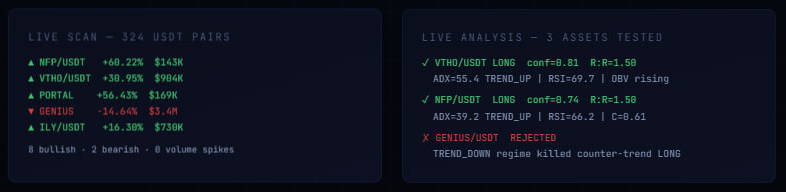

# Live Market Validation

RUNECLAW reads Bitget market data and runs it through its scanner, its analyzer and its risk engine.
This page keeps two kinds of evidence apart:

- **A recorded snapshot** from the hackathon period (on or before 15 Jul 2026): one live scan, three
  analyses and one backtest on real BTC/USDT candles, each run once. The market figures are from that
  day; they are not live.
- **A stress test anyone can re-run**: 500 backtests on generated prices with fixed seeds, last run on
  24 Oct 2026. `python3 run_deep_backtest.py` reproduces it. It is a synthetic smoke test of the
  pipeline. It is not evidence of an edge.

Neither is a forecast. A backtest replays the rules on past or generated prices: it shows how the risk
engine behaves, not what a trade will earn.

---

## The recorded snapshot

The two cards above are cropped from a screenshot of the RUNECLAW website taken during the hackathon.
The crop leaves out the screenshot's heading, which named the exchange sub-account, and its backtest
card, whose results are below as percentages. Nothing inside the two cards is changed.

### Live scan

Scanned **324 USDT pairs** from Bitget spot market. Top 10 by momentum:

| # | Symbol | 24h % | Volume (USD) | Momentum | Direction |
|---|--------|-------|-------------|----------|-----------|
| 1 | NFP/USDT | +60.22% | $143,252 | +1.000 | Bullish |
| 2 | TX/USDT | +10.68% | $75,562 | +1.000 | Bullish |
| 3 | GENIUS/USDT | -14.64% | $3,402,424 | -1.000 | Bearish |
| 4 | ILY/USDT | +16.30% | $730,149 | +1.000 | Bullish |
| 5 | KAIO/USDT | +13.58% | $345,992 | +1.000 | Bullish |
| 6 | BABYSHARK/USDT | -13.28% | $104,481 | -1.000 | Bearish |
| 7 | STG/USDT | +18.30% | $74,175 | +1.000 | Bullish |
| 8 | CLANKER/USDT | +11.18% | $105,272 | +1.000 | Bullish |
| 9 | VTHO/USDT | +30.95% | $904,287 | +1.000 | Bullish |
| 10 | PORTAL/USDT | +56.43% | $169,470 | +1.000 | Bullish |

**Summary:** 8 bullish, 2 bearish signals. No volume spikes detected (first scan: the spike detector
needs a rolling baseline).

### Live analysis

Three assets were run through the full RUNECLAW analyzer (10-voter confluence model, ADX regime
detection, Fibonacci levels, candlestick patterns, OBV, VWAP):

#### VTHO/USDT: LONG (confidence 81%)

| Field | Value |
|-------|-------|
| Direction | LONG |
| Entry | $0.000624 |
| Stop Loss | $0.000462 (-25.9%) |
| Take Profit | $0.000867 (+38.9%) |
| R:R Ratio | 1.50 |
| RSI-14 | 69.7 |
| ADX-14 | 55.4 (very strong trend) |
| Regime | TREND_UP |
| Confluence | 0.68 |
| OBV | Rising |
| Fibonacci Zone | 382-500 retracement |
| Source | RULE_ENGINE |

#### NFP/USDT: LONG (confidence 74%)

| Field | Value |
|-------|-------|
| Direction | LONG |
| Entry | $0.014200 |
| Stop Loss | $0.011287 (-20.5%) |
| Take Profit | $0.018570 (+30.8%) |
| R:R Ratio | 1.50 |
| RSI-14 | 66.2 |
| ADX-14 | 39.2 (strong trend) |
| Regime | TREND_UP |
| Confluence | 0.61 |
| OBV | Rising |
| Fibonacci Zone | 382-500 retracement |
| Source | RULE_ENGINE |

#### GENIUS/USDT: REJECTED

| Field | Value |
|-------|-------|
| Direction | LONG (attempted) |
| Regime | TREND_DOWN |
| Result | **REJECTED** |
| Reason | Regime filter killed counter-trend LONG |

The regime filter blocked a LONG trade in a TREND_DOWN market: the fail-closed design doing what it is
for.

### Backtest: BTC/USDT 1H, real candles

1,440 one-hour candles (60 days), 0.1% commission and 0.05% slippage per trade, on a simulated starting
balance. Every result is a percentage of that starting balance.

| Measure | Result |
|--------|-------|
| Total return | **+3.18%** |
| Commission paid | 0.17% |
| Slippage paid | 0.09% |
| Trades | 5 |
| Winners | 4 (80%) |
| Losers | 1 |
| Average win | +1.33% |
| Average loss | -2.15% |
| Largest win | +2.64% |
| Largest loss | -2.15% |
| Average duration | 30.8 h |
| Max drawdown | -2.45% (from peak equity) |
| Max consecutive losses | 1 |
| Profit factor | 2.48 |
| Sharpe ratio | 1.75 |
| Sortino ratio | 0.79 |
| Calmar ratio | 1.30 |

| Stage | Count | % |
|-------|-------|---|
| Signals scanned | 335 | 100% |
| Ideas generated | 100 | 29.9% |
| Risk-rejected | 95 | -- |
| Confidence-rejected | 235 | -- |
| **Executed** | **5** | **1.5%** |

Out of 335 signals, 5 passed every filter and were executed; the risk engine rejected 95 of the 100
ideas generated. Five trades are too few to measure an edge. What this run shows is the pipeline end to
end, from scan to risk gate to exit, on real prices.

Scanning and analysis read Bitget's public market endpoints (tickers and candles); they need no account
access.

---

## Stress test: 500 runs on generated prices

This is a synthetic smoke test. The prices are generated, and the figures below are not evidence
of an edge.

20 symbols, 5 market regimes (bull trend, bear trend, range/chop, high volatility, crash then
recovery) and 5 fixed seeds: 500 backtests of 1,500 one-hour bars each, on prices generated with
geometric Brownian motion and GARCH volatility. The rule engine decides alone (no LLM), with the same
0.1% commission and 0.05% slippage. Every return is a percentage of each run's simulated starting
balance.

Last run on **24 Oct 2026** at commit `e5ddb3c`. Every run's result, with the parameters its prices
were generated from, is in `backtest_deep_results.json`; run `python3 run_deep_backtest.py` to
reproduce it. Averages are over the runs that traded: a run that opened no position returned exactly
0%, and folding it into an average would pull every figure toward zero.

| Measure | Result |
|---|---|
| Runs completed | 500 of 500 |
| Runs that traded | 416 (84 did not trade) |
| Trades | 7,306 |
| Average return, runs that traded | -0.02% |
| Best run | +3.92% |
| Worst run | -3.44% |
| Profitable runs | 205 of 416 that traded; 205 of 500 in all |
| Median profit factor | 0.98 (4 runs had no losing trade, so no ratio) |
| Average win rate, runs that traded | 57.6% |
| Average max drawdown, runs that traded | 1.37% |
| Worst drawdown | 4.12% |
| Runs past 20% drawdown | 0 |

| Regime | Runs | Traded | Trades | Average return, runs that traded | Profitable runs |
|---|---|---|---|---|---|
| Bull Trend | 100 | 95 | 1,878 | -0.51% | 30 of 95 |
| Bear Trend | 100 | 95 | 1,567 | +0.20% | 54 of 95 |
| Range/Chop | 100 | 95 | 1,615 | +0.00% | 47 of 95 |
| High Volatility | 100 | 36 | 378 | +0.21% | 18 of 36 |
| Crash Recovery | 100 | 95 | 1,868 | +0.16% | 56 of 95 |

**What it shows.** How the risk engine behaves across very different markets: the worst drawdown in any
of the 500 runs was 4.12%, against the 10% maximum drawdown of the default risk settings
(`MAX_DRAWDOWN_PCT` in `bot/config.py`).

**What it does not show.** An edge. The prices are a random walk with a drift and a volatility, with
none of a real market's memory, so what the rules earn on them says little about what they would earn
on a real market. A run that did not trade is counted apart: declining to trade is the regime gate
doing its job, not a loss.

Earlier versions of this page showed a stress-test screenshot (180 runs) that disagreed with its own
table (500 runs), and a card of claims that had gone stale. Both were removed on 15 Oct 2026. The figures
above differ from earlier ones because the backtest engine has changed since; the record names the
commit it ran at, so each figure can be tied to the code that produced it.
